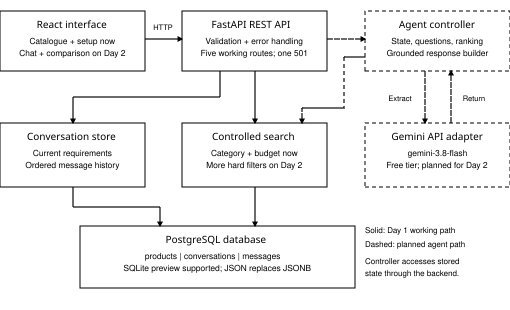
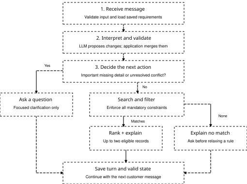
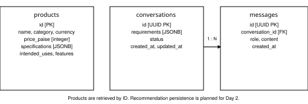

# Electronics Sales Assistant

Proposed System Architecture and Implementation Plan

Help a customer turn an everyday need into **up to two suitable electronics choices**. The final agent will clarify important gaps, remember revisions and explain trade-offs using retrieved catalogue records.

## Component Responsibilities

**Language model:** propose structured requirement changes. **Application:** validate and merge state, decide whether to clarify, enforce hard constraints, rank eligible records and assemble factual responses.

**Stack:** FastAPI + React meet the FARM requirement. PostgreSQL stores products and conversations; SQLite is a tested preview. **Planned AI:** Google Gemini Developer API, Gemini 3.8 Flash, free tier. Provider integration and account quota verification are Day 2 work; see External AI Service.

**Communication:** React exchanges REST requests and JSON responses with FastAPI over HTTP in local development. The backend uses parameterized SQLAlchemy queries over a PostgreSQL connection. The planned Gemini adapter exchanges structured JSON over HTTPS. Only the backend accesses the database and external API.

**Day 1 boundary:** catalogue and conversation setup work. AI message processing is explicitly unavailable (HTTP 501). No invented or simulated AI answer is shown.

# Agent Decision Flow

Planned Day 2 flow; the controller is not implemented in this delivery

Both recommendation and no-match branches will save their response and valid state before the next turn. Failures must not corrupt previously valid requirements. All agent branches above are planned, not running today.

## Conversation State and Clarification Policy

"Maximum INR 70,000; programming; lighter preferred" creates a hard budget and a soft portability preference. "Actually, INR 60,000" replaces only the budget. "Weight does not matter" explicitly removes the weight preference.

**Question policy:** ask only when an unknown or contradiction can materially change a useful recommendation. A complete first request can search immediately. An explicit "no budget limit" is an answer, not a missing value.

**No match:** preserve all hard constraints, explain the mismatch and ask which condition the customer is willing to adjust. Do not silently relax a budget or invent a product.

# Database Design

36 fictional catalogue records: 24 laptops and 12 headphones; INR only

| Record | Structured content |
| --- | --- |
| Laptop specifications | RAM, storage, CPU, GPU, VRAM where applicable, weight and operating system. |
| Headphone specifications | Connection type, microphone, noise cancellation, weight, battery hours and battery applicability. |
| Requirement state | Category, intended uses, mandatory constraints, preferences, explicit no-preference answers and unresolved questions. |
| Sample-data coverage | Budget boundaries, several/one/no eligible matches, portability trade-offs and unknown optional specifications. |

## Data rules

**Money:** integer paise, so INR 70,000 is stored as 7,000,000. **Unknowns:** null means not specified; battery applicability distinguishes unknown wireless battery life from a wired product with no battery.

**Persistence:** conversations own their messages through a foreign key. Retrieval orders history by timestamp and ID. JSONB is used on PostgreSQL; JSON is used in the SQLite preview. Day 2 updates must replace or explicitly track changed JSON state.

**Seed safety:** validate records before insertion; skip existing IDs and preserve edits. Synthetic intended-use tags are not measured performance claims. No recommendation may cite an attribute absent from the retrieved record.

# Backend API and System Controls

All six required endpoint paths are documented; five are functional today

| Endpoint | Day 1 behaviour |
| --- | --- |
| GET /api/v1/products | 200: category and inclusive max-price filters; stable ordering; pagination and total count. |
| GET /api/v1/products/{product_id} | 200 stored product; 404 if absent. |
| POST /api/v1/conversations | 201: persist a UUID conversation with empty requirement state. |
| GET /api/v1/conversations/{conversation_id} | 200: current state and ordered history; 404 if absent. |
| POST /api/v1/conversations/{conversation_id}/messages | 501 for a valid known conversation: agent_not_implemented. No message is saved. Invalid input: 422. Unknown conversation: 404. |
| GET /api/v1/health | 200 when the database connects; 503 otherwise. Reports agent not implemented. Connectivity only, not schema readiness. |

## Validation and Reliability Controls

**Implemented:** validated API inputs, safe parameterized queries, typed sample specifications, database constraints and sanitized errors. Catalogue sorting is price then ID; it is not recommendation ranking.

**Planned:** allowlisted agent tools; schema-validated model output; bounded timeouts/recovery; hard-constraint filtering before scoring; grounded explanations; atomic state/message processing and per-conversation concurrency control.

**Local use:** no authentication or public deployment is included. Model credentials will remain in the backend. React never receives secrets. Product data comes from the database, not model memory.

**Documentation:** live Swagger UI at /docs, OpenAPI at /openapi.json, plus a saved schema snapshot in docs/openapi.json. Configuration templates and exact setup commands are included in the README.

# Implementation Plan and Day 1 Coverage

A realistic route from today's architecture to the final demonstration

| Milestone | Deliverable and exit condition |
| --- | --- |
| Day 1 - 19 October
9:00 PM check-in | Submit this architecture. Foundation: catalogue, persistence, API contracts, minimal UI, setup guide and initial tests. |
| Day 2 - 20 October
9:00 PM check-in | Submit progress README. Implement real extraction, requirement memory, clarification, eligibility/ranking, grounded responses and behavioural tests. |
| Day 3 - 21 October
Google Meet; time to follow | Finalize code, schema/sample data, tests and configuration. Verify clean setup, rehearse, explain trade-offs and be ready to debug live. |

## Verification and current limits

Backend: 40 automated tests passed with isolated SQLite databases. Frontend: TypeScript checking and production build passed. Chromium: 11 browser smoke checks passed, including filtering, persistence, error recovery and mobile overflow. PostgreSQL execution remains unverified.

**Not yet verified or implemented:** PostgreSQL integration execution, real-model conversations, recommendation quality, concurrent turn handling and public-hosting controls. These are explicit follow-up work, not completed claims.

## Day 1 Submission Coverage

| Required element | Location and content |
| --- | --- |
| Main components | System architecture diagram: React, FastAPI, controller, search, conversation store, database and Gemini adapter. |
| Agent flow | Agent Decision Flow: interpret, validate, clarify or search, filter, rank, explain and save state. |
| Database | Database Design: product, conversation and message entities, relationships and structured fields. |
| API/backend | Backend API and System Controls: six required endpoint paths, responsibilities and status handling. |
| Component communication | System diagram arrows and communication explanation: REST/JSON, database queries, HTTPS model requests and persisted state. |
| Short explanation of plan | Component responsibilities, data rules, implementation milestones and external API integration plan. |

# External AI Service

Selected provider, model, free-tier constraints and planned integration

| Decision | Planned implementation |
| --- | --- |
| External service | Google Gemini Developer API; obtain a backend API key through Google AI Studio. |
| Selected model | Gemini 3.8 Flash, model ID gemini-3.8-flash. Keep the model configurable and confirm account availability before integration. |
| Cost boundary | Use a Free-tier project. Standard input/output tokens are currently listed as free. Do not enable paid billing or automatically fall back to a paid service. |
| Model task | Interpret messages and return structured requirement changes. Validate JSON with Pydantic and check business meaning before changing state. |
| Local application task | Store requirements, enforce constraints, query PostgreSQL, rank eligible records and build product comparisons from retrieved fields. |
| Training and hardware | No local training, fine-tuning, GPU or model downloads. The synthetic catalogue is application data, not a training dataset. |

## Quota-aware integration plan

Target one extraction call per customer turn and build factual comparison text locally. Use bounded input/output sizes, a timeout and at most one bounded retry for recoverable errors. Handle 429/quota exhaustion visibly; never invent an answer or silently switch to paid usage.

Free quotas vary by model, project and account and are not guaranteed. Check active RPM/TPM/RPD limits in AI Studio and perform a small real-key smoke test before the demonstration. No API key or account quota has been tested in this Day 1 delivery.

**Credentials and data:** keep GEMINI_API_KEY only in the backend environment; never in React or Git. The free tier may use submitted content to improve Google products. Send synthetic demo requests and necessary state only, never database credentials or personal customer data.

**Status:** this is a documented provider choice, not a completed integration. Day 1 still returns HTTP 501 for messages. Day 2 implements and verifies the adapter. No Google Search grounding, external shopping data or paid add-on tools are needed.
